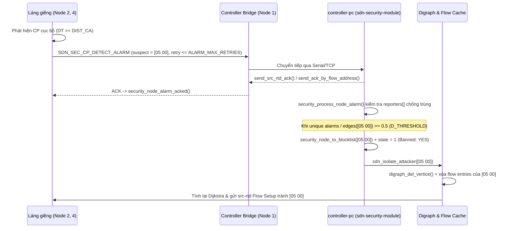

# Kiến trúc Hệ thống IDIT-SDN & Tổng hợp Thay đổi Kỹ thuật (`TASK-05` → `TASK-10`)

Tài liệu này trình bày kiến trúc phát hiện và cô lập xâm nhập 2 tầng của **IDIT-SDN** (*Intrusion Detection Framework for Software Defined Wireless Sensor Networks*), công thức toán học của bộ phát hiện **Change-Point (CP)**, cơ chế tối ưu bộ nhớ **Welford O(1)** trên MSP430, cũng như chi tiết các thay đổi đã triển khai từ `TASK-05` đến `TASK-10`.

---

## 1. Kiến trúc tổng thể 2 tầng (Data Plane + Control Plane)

IDIT-SDN kết hợp giám sát phân tán tại các node cảm biến WSN (chạy **Contiki 3.0**) với phân tích tập trung và phản ứng cô lập trên **SDN Controller (`controller-pc`)** qua kết nối Serial/TCP.

```mermaid
flowchart LR
    subgraph WSN["Mặt phẳng Dữ liệu (Contiki 3.0 Motes)"]
        S["Sensor Nodes (enabled-node)"]
        A["Attacker Node (FDFF / FNI / Flood)"]
        K["Sink Node (sink-node)"]
        C["Controller Bridge (controller-node)"]
        S -->|"Dữ liệu (flow 2017) + Đếm suspect cục bộ"| K
        S -->|"CP cục bộ (-DTRANS_TS / -DENERGY)"| C
        A -.->|"Bơm luồng giả / Neighbor giả / Req flood"| S
        K -->|"TOTAL_DATA (SDN_MNGT_METRIC_TOTAL_DATA)"| C
    end

    subgraph CTRL["Mặt phẳng Điều khiển (Qt5 controller-pc)"]
        SER["Serial/TCP Bridge (sdn-serial-send)"]
        SEC["Security Module (sdn-security-module.c)"]
        DIG["Routing Digraph & Dijkstra (digraph/)"]
        SER -->|"Metrics & Neighbor Reports"| SEC
        SEC -->|"CP Tập trung (Control Overhead & Data PDR)"| SEC
        SEC -->|"Blocklist (alarms/neighbors >= 0.5) -> sdn_isolate_attacker()"| DIG
        DIG -->|"Src-Rtd Flow Setup / Route Update"| SER
    end

    C <-->|"TCP Socket / UART"| SER
```

### Chuỗi phát hiện phân tán, khử trùng & cô lập kẻ tấn công (`TASK-08`)

Khi một node tấn công (ví dụ Node 5) bơm lưu lượng giả (**FDFF**), các node láng giềng ghi nhận lượng gói bất thường (`security_node_add_suspect`) và giám sát biến động truyền dẫn/năng lượng cục bộ (`security_node_cp_detector`). Nếu vượt ngưỡng phân tán (`DIST_CA`), node gửi cảnh báo đáng tin cậy về controller:

---

## 2. Cơ sở toán học: Phát hiện Change-Point & Phương sai Welford O(1)

### 2.1. Thuật toán Change-Point (Tập trung & Phân tán)

Tại tầng tập trung ([controller-server/sdn-security-module.c](file:///home/an-vu/CodingCoding/idit-sdn/controller-server/sdn-security-module.c)), controller thu thập 2 chuỗi thời gian theo chu kỳ `MTENSEC` (`10s` Contiki = `20s` Cooja Z1):
1. **Control Packets Overhead (`CTRL_PCKTS_OVHD`)**: Phát hiện ngập control plane (**FDFF**, **Request Flood**).
2. **Data Packets Delivery Rate (`DATA_PCKTS_DR`)**: Phát hiện sụt giảm tỷ lệ giao gói do đầu độc bảng định tuyến (**FNI**).

Sau khi hoàn tất giai đoạn huấn luyện độ dài $M = \text{M\_WIN} - \text{S\_SKIP}$ mẫu hợp lệ với tổng $Q_1$ và phương sai $\text{Var}$, ở bước giám sát $i_s \ge 1$, thống kê kiểm định $DT$ được tính theo:

$$DT = \frac{\left| Q_2 - \frac{i_s}{M} \cdot Q_1 \right|}{\sqrt{M \cdot \text{Var}} \cdot \left(1 + \frac{i_s}{M}\right) \cdot \left(\frac{i_s}{i_s + M}\right)^\gamma}$$

Trong cấu hình chuẩn ($\gamma = 0.45$, $\text{sig\_lvl} = 0.95$), ngưỡng tới hạn là $c_a = 2.7907$ (`2.79`). Hệ thống bật cờ `CP detected` nếu $DT \ge c_a$ (với nhánh bảo vệ `denominator <= 0.0` → $DT = 0.0$ để tránh `NaN`). Tại tầng phân tán ([sdn-common/sdn-node-security-module.c](file:///home/an-vu/CodingCoding/idit-sdn/sdn-common/sdn-node-security-module.c)), mỗi mote sử dụng `DIST_M_WIN` (`21` trên lưới demo, `201` mặc định) và `DIST_D_WIN` (`50`, `DIST_CA = 2.82f`).

### 2.2. Tối ưu RAM khi kết hợp `-DTRANS_TS` và `-DENERGY` (`TASK-05`)

Mote MSP430 **Z1** chỉ có 8 KB RAM (`bss + data` an toàn dưới ~7.8 KB). Nếu cấp phát thêm hai mảng tĩnh `energy_training[201]` + `energy_monitoring[50]` (~502 B) song song với mảng của `-DTRANS_TS`, firmware vượt ngưỡng RAM (`7828 B` trên Z1, tràn `.bss` 38 B trên Sky).

Giải pháp trong [sdn-node-security-module.c](file:///home/an-vu/CodingCoding/idit-sdn/sdn-common/sdn-node-security-module.c):
- Khi chạy **độc lập `-DENERGY`**: Sử dụng trực tiếp mảng `training[]` và `monitoring[]` sau khi đã sửa lỗi gọi nhầm `security_node_ts_monitoring(..., ts_counter - m_win)` thành `security_node_ts_training(...)`.
- Khi bật **kết hợp `-DENERGY` + `-DTRANS_TS` / `-DRX_CTRL_PCKT`**: Chỉ giữ trạng thái thống kê **Welford O(1) online variance** (~22 B RAM: bộ đếm, tổng $Q_1, Q_2$, `mean`, `M2`) và hàm `security_node_consumption_mJ_from_tx()` để dùng chung delta `last_tx` của Energest mà không đọc lặp làm mất tick.

---

## 3. Tổng hợp thay đổi mã nguồn (`TASK-05` → `TASK-10`)

Mọi hằng số/tính năng mới đều giữ tương thích ngược với cấu hình 36 node mặc định thông qua `#ifndef ... #endif` hoặc macro tùy chọn.

| Task | Thành phần & File chính | Thay đổi cốt lõi & Ký hiệu liên quan |
| :--- | :--- | :--- |
| **`TASK-05`** | [sdn-node-security-module.h](file:///home/an-vu/CodingCoding/idit-sdn/sdn-common/sdn-node-security-module.h), [sdn-node-security-module.c](file:///home/an-vu/CodingCoding/idit-sdn/sdn-common/sdn-node-security-module.c) | Sửa ghi âm ngoài biên `monitoring[]` khi training `-DENERGY`; bổ sung `security_node_consumption_mJ_from_tx()`; dùng Welford O(1) khi bật cùng `-DTRANS_TS`; sửa off-by-one `ts_counter >= m_win + d_win - 1` và `security_new_period()`. |
| **`TASK-06`** | [attack-three.c](file:///home/an-vu/CodingCoding/idit-sdn/applications/attack-three.c), [sdn-metrics-cal.c](file:///home/an-vu/CodingCoding/idit-sdn/controller-server/sdn-metrics-cal.c), [attack-fni/](file:///home/an-vu/CodingCoding/idit-sdn/applications/attack-fni/Makefile_intrusion) | Loại bỏ `malloc` trong `copy_neighbor_packet` bằng buffer tĩnh `neighbor_buf[4]` + `sdn_packetbuf_pool_get()`; thêm `inject_synthesized_false_nr_for_addr()` và cờ `#ifdef FNI_BROAD_POISON`; tham số hóa `TOTAL_EXPECTED_DATA_PCKTS` (`7.0f` cho lưới 3×3, mặc định vẫn `222.0f`). |
| **`TASK-07`** | [attack-two.c](file:///home/an-vu/CodingCoding/idit-sdn/applications/attack-two.c), [attack-two-demo/](file:///home/an-vu/CodingCoding/idit-sdn/applications/attack-two-demo/Makefile_node) | In log `"Sending false flow request: %d"`, bọc `ids_timer` dưới `#ifdef IDS`, cấu hình kịch bản cổng `60012` với `-DATTACK_PERIOD=4`. |
| **`TASK-08`** | [sdn-process-packets.c](file:///home/an-vu/CodingCoding/idit-sdn/sdn-common/sdn-process-packets.c), [sdn-send-packet.c](file:///home/an-vu/CodingCoding/idit-sdn/sdn-common/sdn-send-packet.c), [sdn-security-module.c](file:///home/an-vu/CodingCoding/idit-sdn/controller-server/sdn-security-module.c), [sdn-process-packets-controller.c](file:///home/an-vu/CodingCoding/idit-sdn/controller-server/sdn-process-packets-controller.c), [sdn-flow-table-cache.c](file:///home/an-vu/CodingCoding/idit-sdn/controller-server/sdn-flow-table-cache.c), [dijkstra.c](file:///home/an-vu/CodingCoding/idit-sdn/controller-server/digraph/dijkstra.c), [digraph.c](file:///home/an-vu/CodingCoding/idit-sdn/controller-server/digraph/digraph.c) | Truyền tin cậy & retry `SDN_SEC_CP_DETECT_ALARM` (`ALARM_MAX_RETRIES=5`) kèm ACK (`security_node_alarm_acked()`); khử trùng theo địa chỉ nguồn trong `reporters[]`; sửa `digraph_find_vertice` trong Dijkstra & `break` trong `digraph_del_edges_to`; thêm `security_is_node_banned()` & `sdn_isolate_attacker()` xóa đỉnh tấn công khỏi đồ thị và bảng luồng. |
| **`TASK-09`** | [sdn-serial.c](file:///home/an-vu/CodingCoding/idit-sdn/contiki-sdn/sdn-serial.c), [Dockerfile](file:///home/an-vu/CodingCoding/idit-sdn/Dockerfile), [mainwindow.cpp](file:///home/an-vu/CodingCoding/idit-sdn/controller-server/controller-pc/mainwindow.cpp) | Tách driver UART cho `z1` (`uart0`), `sky` (`uart1`), CC2538 `remote`/`zoul`/`openmote` (`dev/uart.h`), `iotlab-m3` (`uart1_set_input` giữ 500k baud); thêm `gcc-arm-none-eabi`, `python3-matplotlib`, `socat`; hỗ trợ `SDN_CONTROLLER_HOST`, `SDN_CONTROLLER_PORT`, `SDN_CONTROLLER_SERIAL`. |
| **`TASK-10`** | [evaluate_ids.py](file:///home/an-vu/CodingCoding/idit-sdn/simulation/evaluate_ids.py), [run_simulations.sh](file:///home/an-vu/CodingCoding/idit-sdn/simulation/run_simulations.sh), [run_attack_demo.sh](file:///home/an-vu/CodingCoding/idit-sdn/simulation/run_attack_demo.sh) | Hỗ trợ headless `-Djava.awt.headless=true`; chuẩn hóa parser cả dấu thập phân `,` (log 36 node) & `.`; xuất 8 CSV, 4 biểu đồ PNG (`matplotlib` `Agg`), và báo cáo [full_experiment_report.md](file:///home/an-vu/CodingCoding/idit-sdn/simulation/results/full_experiment_report.md). |

---

## 4. Cờ biên dịch & Quy đổi đồng hồ Z1 trong Cooja

| Tham số / Cờ | Giá trị mặc định (36 node) | Giá trị Demo Z1 (9 node) | Tác dụng |
| :--- | :--- | :--- | :--- |
| `SENSING_AT_SECONDS` | `60` | `20` (FDFF/Energy), `10` (FNI) | Chu kỳ gửi gói dữ liệu cảm biến (`sdn_send`) |
| `MTENSEC` / `MSIXTYSEC` | `MSIXTYSEC` (60s) | `MTENSEC` (10s Contiki = 20s Cooja) | Chu kỳ lấy mẫu `sdn_security_sample()` trên controller |
| `S_SKIP` / `M_WIN` | `10` / `210` | `38` / `60` (IoT-LAB: `25` / `45`) | Bỏ `S_SKIP` mẫu khởi động; cửa sổ training đến mẫu `M_WIN` |
| `DIST_M_WIN` / `DIST_INIT_DELAY` | `201` / `600` | `21` / `60` | Cửa sổ training phân tán và trễ khởi động tại mote |
| `TOTAL_EXPECTED_DATA_PCKTS` | `222.0f` | `7.0f` (FNI 9 node) | Mẫu số chuẩn hóa `sdn_cal_data_dr()` tính % PDR |
| `ATTACK_TRIGGER` / `ATTACK_PERIOD` | `600`–`7000` / `60` | `480`–`550` / `10` (`4` cho Flood) | Thời điểm & chu kỳ phát tấn công (giây Contiki) |
| `FNI_BROAD_POISON` | Tắt | Bật trong `attack-fni` & `fit-iotlab` | Đầu độc xoay vòng nhiều láng giềng `u8[0] > 3` trừ trục `1-2-3` |

> **Lưu ý đồng hồ Z1 trong Cooja**: Trên trình giả lập MSPSim cho Z1, mỗi **1 giây Contiki (`CLOCK_SECOND`) trôi chậm gấp đôi (~2.0 giây thời gian Cooja)**. Do đó `ATTACK_TRIGGER = 550s` Contiki kích hoạt ở ~`1235s` Cooja, và `M_WIN = 60` (`600s` Contiki) kết thúc pha training ở ~`1200s` Cooja (Sample 60).
