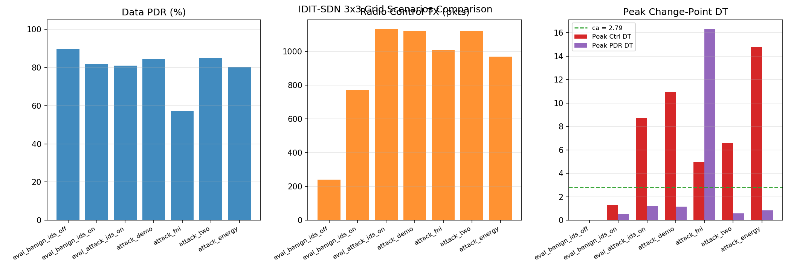
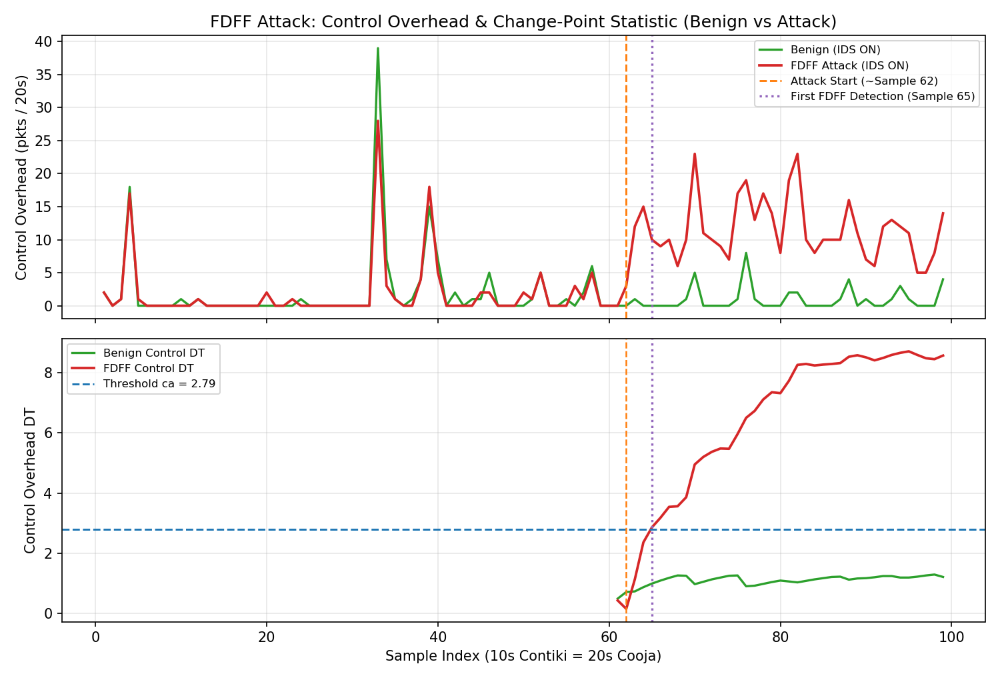
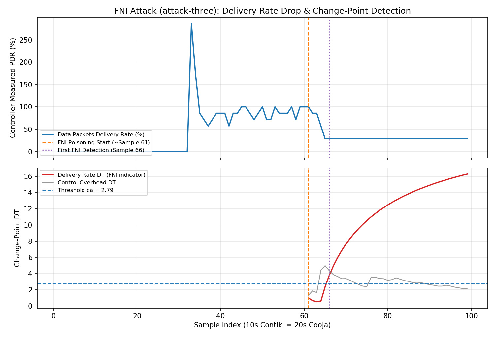
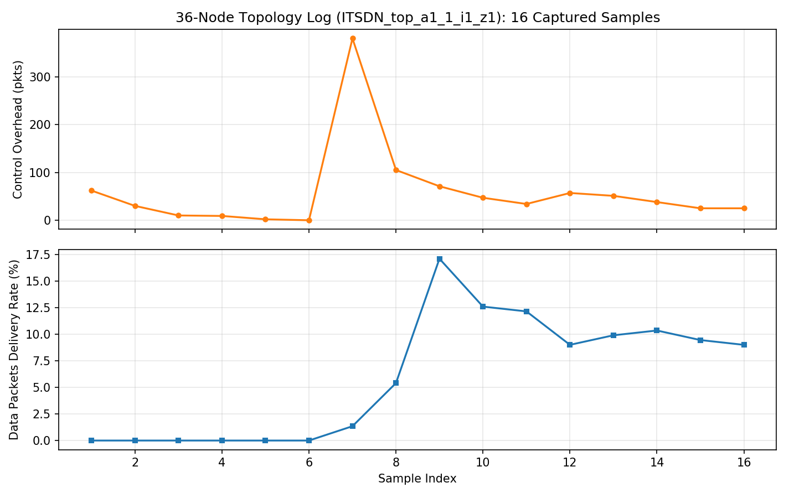

# Báo cáo Thí nghiệm & Kết quả Đo đạc IDIT-SDN

Tài liệu này tổng hợp đầy đủ thiết kế thực nghiệm, kết quả mô phỏng Cooja cho toàn bộ 7 kịch bản trên lưới 3×3 (Z1 MSP430), log đối chứng 36 node, phân tích chi phí IDS (ROM/RAM/Energy/Control Overhead), và các biểu đồ/CSV đã xuất từ [evaluate_ids.py](file:///home/an-vu/CodingCoding/idit-sdn/simulation/evaluate_ids.py).

---

## 1. Thiết lập Thí nghiệm & Cô lập Cổng

- **Mô hình mạng thử nghiệm**: 9 node Z1 trên lưới `3×3` bước `35 m` (`0..70 m`), bán kính truyền & nhiễu UDGM `45 m`, thời gian mô phỏng mỗi kịch bản `2000 s` Cooja:
  - **Node 1**: `controller-node` (`[0, 0]`) — cầu nối serial TCP về `controller-pc`.
  - **Node 3**: `sink-node` (`[70, 0]`) — nhận dữ liệu flow `2017` và gửi báo cáo `TOTAL_DATA`.
  - **Node 5**: Vị trí trung tâm (`[35, 35]`) — node hợp lệ (`enabled-node`) trong kịch bản Benign, hoặc node tấn công (`attack-fdff`, `attack-three`, `attack-two`) trong kịch bản Attack.
  - **Nodes 2, 4, 6, 7, 8, 9**: Các node `enabled-node` gửi dữ liệu định kỳ về Sink 3.
- **Cô lập kịch bản**: Mỗi kịch bản chạy trên một cổng `SDN_CONTROLLER_PORT` riêng để tránh xung đột với cấu hình mặc định `60001`:
  - `60010`: Bộ đánh giá A/B (`eval_*`) và Demo FDFF + Cô lập (`run_attack_demo.sh`).
  - `60011`: Tấn công FNI sửa đổi Neighbor Report (`run_fni_demo.sh`).
  - `60012`: Tấn công Control-Plane Request Flood (`run_attack_two_demo.sh`).
  - `60013`: Kiểm chứng đa chỉ số `-DTRANS_TS -DENERGY` (`run_energy_test.sh`).

---

## 2. Bảng tổng hợp toàn bộ các kịch bản (`summary_all_scenarios.csv`)

Nguồn dữ liệu: [full_experiment_report.md](file:///home/an-vu/CodingCoding/idit-sdn/simulation/results/full_experiment_report.md) và [summary_all_scenarios.csv](file:///home/an-vu/CodingCoding/idit-sdn/simulation/results/csv/summary_all_scenarios.csv).

| Kịch bản | Loại | TX / RX | PDR (%) | Delay TB (ms) | Radio Ctrl TX | Energy 2..9 (mJ) | Samples | Peak Ctrl DT | Peak PDR DT | Phát hiện Tập trung (First / Count) | Cô lập (`Banned: YES`) |
| :--- | :--- | ---: | ---: | ---: | ---: | ---: | ---: | ---: | ---: | :--- | :--- |
| `eval_benign_ids_off` | 3×3 | 77 / 69 | 89.61% | 12942.29 | 241 | 9220 | 0 | - | - | - | - |
| `eval_benign_ids_on` | 3×3 | 77 / 63 | 81.82% | 3921.65 | 771 | 19919 | 99 | 1.29 | 0.56 | **FPR = 0.00%** (0/39) | - |
| `eval_attack_ids_on` | 3×3 | 79 / 64 | 81.01% | 3693.35 | 1131 | 23933 | 99 | **8.71** | 1.19 | FDFF: Sample 65 (`35/38` = **92.11%**) | `[ 05 00 ]` |
| `attack_demo` | 3×3 | 77 / 65 | 84.42% | 3859.11 | 1124 | 24858 | 99 | **10.93** | 1.16 | FDFF: Sample 64 (36 cửa sổ) | `[ 05 00 ]` |
| `attack_fni` | 3×3 | 501 / 287 | 57.29% | 2536.54 | 1008 | 28461 | 99 | 4.97 | **16.28** | **FNI: Sample 66 (34 cửa sổ)** | - |
| `attack_two` | 3×3 | 81 / 69 | 85.19% | 3304.00 | 1123 | 23219 | 99 | **6.60** | 0.59 | CP Ctrl-Ov: Sample 66 (34 cửa sổ) | - |
| `attack_energy` | 3×3 | 66 / 53 | 80.30% | 4377.10 | 970 | 20974 | 89 | **14.80** | 0.85 | FDFF: Sample 64 (26 cửa sổ) | `[ 05 00 ]` |
| `n36_ITSDN_n36_top_a1_1_i1_z1` | 36 node | - | - | - | 331 | - | 16 | - | - | Pha khởi tạo (5% tiến độ gốc) | - |



---

## 3. Đánh giá A/B: Hiệu năng, Tỷ lệ phát hiện & Chi phí IDS ([evaluation_report.md](file:///home/an-vu/CodingCoding/idit-sdn/simulation/results/evaluation_report.md))

### 3.1. Detection Rate (TPR), False Positive Rate (FPR) & Detection Delay (FDFF)

- **Benign (`IDS ON`)**:
  - **Tập trung**: `0/39` cửa sổ giám sát cảnh báo nhầm (**FPR = 0.00%**), đỉnh `DT = 1.29 < 2.79`.
  - **Phân tán**: `0/7` node phát cảnh báo CP (**FPR = 0.00%**).
- **FDFF Attack (`IDS ON`, tấn công tại `t = 1235.48 s`, 156 gói luồng giả)**:
  - **Tập trung**: Phát hiện **35/38 cửa sổ sau tấn công (92.11%)**, bắt đầu từ **Sample 65** (độ trễ phát hiện ~`64.52 s`), đỉnh **`DT = 8.71`** so với ngưỡng `ca = 2.79`.
  - **Phân tán & Cô lập**: `4/4` láng giềng trực tiếp `[2, 4, 6, 8]` đều ghi nhận suspect `[ 05 00 ]`; `2` láng giềng `[2, 6]` gửi alarm tin cậy về controller (`Alarms: 2 / 4 = 0.5 >= D_THRESHOLD`), đưa `[ 05 00 ]` vào Blocklist (`Banned: YES`). Trên toàn cục, trước tấn công PDR là `81.08%`, trong tấn công giảm xuống `69.05%` (`t >= 1235.5 s`, Delay TB tăng nhẹ lên `3182.79 ms` trước khi tuyến được cập nhật).



### 3.2. Chi phí Bộ nhớ (ROM/RAM trên Z1 MSP430) & Chi phí Vận hành

| Thành phần đo | IDS OFF | IDS ON | Chênh lệch (Chi phí IDS) |
| :--- | ---: | ---: | :--- |
| `enabled-node.z1` ROM / RAM | `41767 B` / `6642 B` | `48435 B` / `6992 B` | **+6668 B (+15.96%) ROM** / **+350 B (+5.27%) RAM** |
| `sink-node.z1` ROM / RAM | `41405 B` / `6602 B` | `42887 B` / `6930 B` | **+1482 B (+3.58%) ROM** / **+328 B (+4.97%) RAM** |
| `controller-node.z1` ROM / RAM | `33165 B` / `6560 B` | `33535 B` / `6816 B` | **+370 B (+1.12%) ROM** / **+256 B (+3.90%) RAM** |
| Control packets khởi phát (9 node, 2000s) | `241` | `771` (`227` SDN / `544` IDS) | **+530 (+219.92%)** |
| Năng lượng Node 2..9 (2000s) | `9220 mJ` | `19919 mJ` | **+10699 mJ (+116.04%)** |
| PDR / Delay TB (Benign) | `89.61%` / `12942.29 ms` | `81.82%` / `3921.65 ms` | `-7.79 pp` / `-9020.64 ms (-69.70%)` |

*(Ghi chú: Trong kịch bản `eval_benign_ids_on`, `controller-pc` thiết lập flow sớm hơn giúp giảm trễ khởi tạo của vài gói dữ liệu đầu phiên, giải thích vì sao Delay TB thấp hơn `eval_benign_ids_off` dù control traffic cao hơn.)*

---

## 4. Phân tích chuyên sâu các Kịch bản tấn công & Kiểm thử bổ sung

### 4.1. Kịch bản Demo FDFF + Phân loại & Cô lập (`TASK-04` + `TASK-08`)
- Trên cổng `60010` ([run_attack_demo.sh](file:///home/an-vu/CodingCoding/idit-sdn/simulation/run_attack_demo.sh)), Node 2 (`Sample 28`) và Node 4 (`Sample 38`, thành công ở lần thử lại `2/5`) nhận được ACK `CP alarm acknowledged`.
- Controller chuyển từ `First suspect: [ 05 00 ]` → `New alarm: [ 05 00 ], Alarms: 2` → `Attacker indentified: [ 05 00 ]` → `Isolating attacker [ 05 00 ] from routing digraph` → cập nhật tuyến `Flow ID route was updated` cho Node 4 (`next_hop [ 01 00 ]`) và Node 8 (`next_hop [ 09 00 ]`), từ chối gói cảnh báo lặp từ Node 4 (`Duplicate alarm ignored`).

### 4.2. Kịch bản FNI — Giả mạo Neighbor Report (`TASK-06`)
- Khi đồng bộ `SENSING_AT_SECONDS=10` với chu kỳ lấy mẫu `MTENSEC`, pha training ổn định ở `Average = 86.36%` với phương sai giảm mạnh xuống `Var = 138.72`.
- Từ `t = 1217.48 s`, Node 5 tiêm 40 Neighbor Report giả xoay vòng `[ 08 00 ]`, `[ 09 00 ]`, `[ 06 00 ]`, `[ 04 00 ]` làm controller tính sai đồ thị (`action 4` DROP route trên các node bị đầu độc).
- **Tác động**: PDR thực tế trên dữ liệu cảm biến giảm từ **`85.96%` (`196/228`) trước tấn công xuống `32.23%` (`88/273`) trong tấn công** (-53.73 pp).
- **Phát hiện**: `Delivery rate DT` vượt ngưỡng `ca = 2.79` từ **Sample 66** (`DT = 3.77`), phát hiện **`FNI attack detected`** liên tục 34 cửa sổ cho tới Sample 99 (đỉnh **`DT = 16.28`**).



### 4.3. Kịch bản Control-Plane Request Flood (`TASK-07`)
- Chạy trên cổng `60012` với `ATTACK_PERIOD=4` (khởi phát lúc `t = 1115.48 s`), Node 5 gửi `111` gói `sdn_send_data_flow_request(random_flow)` làm `Total overhead` đạt `520` (Radio Control TX `1123`).
- Controller phát hiện bất thường Control Overhead từ **Sample 66** (`DT = 3.08 >= 2.79`), duy trì 34 cửa sổ tới Sample 99 với đỉnh **`DT = 6.60`** (thấp hơn so với đỉnh FDFF `8.71–10.93` do Request Flood chỉ gây overhead điều khiển từ một điểm phát thay vì kích hoạt forward đa chặng với cờ unknown flow).

### 4.4. Kiểm chứng `-DTRANS_TS` + `-DENERGY` (`TASK-05`) & Log 36 node (`TASK-10`)
- Kịch bản `attack_energy` xác nhận mote xuất đầy đủ cặp giá trị `Transmitting time` và `Consumption (mJ)` suốt pha training & monitoring, đồng thời controller phát hiện FDFF tại Sample 64 (đỉnh `DT = 14.80`) và cô lập `[ 05 00 ]`.
- Bộ parser `evaluate_ids.py` xử lý được định dạng số phẩy thập phân (locale `pt_BR`) và byte `NUL` trong [controller_ITSDN_n36_top_a1_1_i1_z1.txt](file:///home/an-vu/CodingCoding/idit-sdn/simulation/results/controller_ITSDN_n36_top_a1_1_i1_z1.txt), trích xuất 16 mẫu khởi tạo (`Total overhead = 946`, `Radio Control TX = 331`).



---

## 5. Tài liệu dữ liệu & Lệnh tái lập thí nghiệm

### Danh sách file dữ liệu CSV
- Tổng hợp: [summary_all_scenarios.csv](file:///home/an-vu/CodingCoding/idit-sdn/simulation/results/csv/summary_all_scenarios.csv)
- Chuỗi thời gian từng kịch bản: [ts_eval_benign_ids_on.csv](file:///home/an-vu/CodingCoding/idit-sdn/simulation/results/csv/ts_eval_benign_ids_on.csv), [ts_eval_attack_ids_on.csv](file:///home/an-vu/CodingCoding/idit-sdn/simulation/results/csv/ts_eval_attack_ids_on.csv), [ts_attack_demo.csv](file:///home/an-vu/CodingCoding/idit-sdn/simulation/results/csv/ts_attack_demo.csv), [ts_attack_fni.csv](file:///home/an-vu/CodingCoding/idit-sdn/simulation/results/csv/ts_attack_fni.csv), [ts_attack_two.csv](file:///home/an-vu/CodingCoding/idit-sdn/simulation/results/csv/ts_attack_two.csv), [ts_attack_energy.csv](file:///home/an-vu/CodingCoding/idit-sdn/simulation/results/csv/ts_attack_energy.csv), [ts_n36_ITSDN_n36_top_a1_1_i1_z1.csv](file:///home/an-vu/CodingCoding/idit-sdn/simulation/results/csv/ts_n36_ITSDN_n36_top_a1_1_i1_z1.csv)

### Tái lập toàn bộ thí nghiệm trong Docker `idit-sdn`

```bash
# Chạy từng kịch bản mô phỏng độc lập
docker exec -w /root/idit-sdn/simulation idit-sdn ./run_evaluation_suite.sh   # Bộ A/B (cổng 60010)
docker exec -w /root/idit-sdn/simulation idit-sdn ./run_attack_demo.sh       # FDFF + Blocklist (60010)
docker exec -w /root/idit-sdn/simulation idit-sdn ./run_fni_demo.sh          # FNI (60011)
docker exec -w /root/idit-sdn/simulation idit-sdn ./run_attack_two_demo.sh   # Request Flood (60012)
docker exec -w /root/idit-sdn/simulation idit-sdn ./run_energy_test.sh       # TRANS_TS + ENERGY (60013)

# Tái tạo toàn bộ báo cáo, CSV và biểu đồ PNG từ log
docker exec -w /root/idit-sdn/simulation idit-sdn python3 evaluate_ids.py
```
