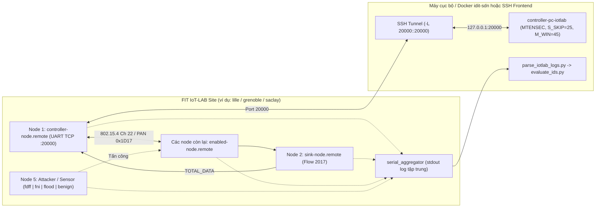

# Triển khai IDIT-SDN trên Phần cứng thật FIT IoT-LAB

Thư mục [`hardware/fit-iotlab/`](file:///home/an-vu/CodingCoding/idit-sdn/hardware/fit-iotlab/README.md) cung cấp trọn bộ cấu hình phần cứng thực tế (`LINKADDR_CONF_SIZE=2`, kênh 802.15.4 & PAN ID cô lập), kịch bản cross-compile ARM Cortex-M3 / MSP430 (`build_iotlab.sh`), script tự động đặt node & nạp firmware (`run_experiment.sh`), và công cụ chuẩn hóa log (`parse_iotlab_logs.py`) tương thích hoàn toàn với bộ đánh giá `simulation/evaluate_ids.py`.

---

## 1. Kiến trúc Triển khai trên Testbed FIT IoT-LAB



### Phân vai mặc định cho đội hình 9 node (`--nodes id1,...,id9`)

| Vị trí trong danh sách | Firmware nạp | Vai trò |
| :--- | :--- | :--- |
| Node thứ 1 (`idx 0`) | `controller-node` | Giao tiếp Serial-over-TCP (`port 20000`) với `controller-pc` |
| Node thứ 2 (`idx 1`) | `sink-node` | Đích thu thập dữ liệu (`flowid = 2017`), báo cáo `SDN_MNGT_METRIC_TOTAL_DATA` |
| Node thứ 5 (`idx 4`, hoặc cuối nếu `<5` node) | Tùy kịch bản (`enabled-node` / `attack-fdff` / `attack-three` / `attack-two`) | Node tấn công (hoặc node thường ở kịch bản `benign`) |
| Các node còn lại | `enabled-node` | Node cảm biến + bộ phát hiện Change-Point cục bộ |

---

## 2. Nền tảng hỗ trợ & Thông số đã hiệu chỉnh cho Thời gian thực

### Nền tảng phần cứng

1. **`TARGET=remote` / `BOARD=firefly` (ARM Cortex-M3 CC2538 — Khuyên dùng)**: Biên dịch trực tiếp bằng `arm-none-eabi-gcc 9.2.1` trên Contiki 3.0 sẵn có trong container `idit-sdn`. Phù hợp trên các site có node **Firefly** (như `lille`).
2. **`TARGET=iotlab-m3` (ARM Cortex-M3 STM32 + AT86RF231 — site `grenoble` / `lille` / `saclay`)**: Biên dịch khi trỏ `CONTIKI=/path/to/iot-lab-contiki`. Code trong `contiki-sdn/sdn-serial.c` tự động giữ nguyên baudrate **`500000`** qua `uart1_set_input()` mà không ghi đè UART1.
3. **`TARGET=z1` / `sky` (Mote MSP430 cắm USB cục bộ)**: Hỗ trợ kết nối trực tiếp qua biến môi trường `SDN_CONTROLLER_SERIAL=/dev/ttyUSB0`.

### Bảng kích thước Firmware ARM đã biên dịch kiểm chứng (`TARGET=remote`)

Đo bằng `arm-none-eabi-size hardware/fit-iotlab/build/remote/*.remote`:

| Firmware | `text` (B) | `data` (B) | `bss` (B) | Tổng (`dec`, B) |
| :--- | ---: | ---: | ---: | ---: |
| `enabled-node.remote` | 45969 | 1402 | 10540 | 57911 |
| `sink-node.remote` | 39885 | 313 | 10452 | 50650 |
| `controller-node.remote` | 31649 | 269 | 10187 | 42105 |
| `attack-fdff.remote` | 40399 | 313 | 10524 | 51236 |
| `attack-two.remote` | 40190 | 313 | 10500 | 51003 |
| `attack-three.remote` | 41863 | 314 | 11020 | 53197 |

### Thông số hiệu chỉnh cho phiên chạy 20 phút phần cứng thật

- `project-conf-iotlab.h`: `LINKADDR_CONF_SIZE=2`, `IOTLAB_RF_CHANNEL=22`, `IOTLAB_PAN_ID=0x1D17`, `SDN_PACKETBUF_POOL_SIZE=16`, `SDN_SEND_QUEUE_SIZE=12`, `SDN_RECV_QUEUE_SIZE=12`, tùy chọn `IOTLAB_TX_POWER` & `IOTLAB_USE_NULLRDC=1`.
- Mote Makefiles (`Makefile_node`, `Makefile_intrusion`): `SENSING_AT_SECONDS=10` (đồng bộ với `MTENSEC`), `ATTACK_TRIGGER=480` (~phút thứ 8), `ATTACK_PERIOD=4`, `DIST_M_WIN=21`, `DIST_INIT_DELAY=60`, `FNI_BROAD_POISON`, `-DTRANS_TS -DENERGY`.
- `controller-pc-iotlab.pro`: `MTENSEC` (`10s` thực tế), `S_SKIP=25`, `M_WIN=45` (~7.5 phút training xong trước khi `ATTACK_TRIGGER=480s` kích hoạt), `TOTAL_EXPECTED_DATA_PCKTS=7.0f`.

---

## 3. Quy trình Chạy thực nghiệm từ đầu đến cuối

### Bước 1: Chuẩn bị CLI & Xác thực FIT IoT-LAB (trên máy cục bộ hoặc SSH Frontend)

```bash
# Kiểm tra toolchain & đăng nhập FIT IoT-LAB
iotlab-auth -u <iotlab_username>

# Kiểm tra các node đang rảnh (Alive) trên site Lille (ví dụ Firefly)
iotlab-status --nodes --site lille --archi firefly:cc2538 --state Alive
```

### Bước 2: Biên dịch Firmware & `controller-pc-iotlab`

```bash
# Biên dịch trong container idit-sdn
docker exec -w /root/idit-sdn/hardware/fit-iotlab idit-sdn ./build_iotlab.sh remote

# (Tùy chọn) Đổi kênh RF, PAN ID, giảm công suất phát để ép topo đa chặng, hoặc bật NullRDC:
docker exec -w /root/idit-sdn/hardware/fit-iotlab idit-sdn env RF_CHANNEL=24 PAN_ID=0x1D17 TX_POWER=0xD5 USE_NULLRDC=1 ./build_iotlab.sh remote
```

Đầu ra nằm tại `hardware/fit-iotlab/build/remote/*.{remote,elf,bin}` và `controller-server/build-controller-pc-iotlab/controller-pc`.

### Bước 3: Kiểm tra kế hoạch triển khai (`--dry-run`)

```bash
./hardware/fit-iotlab/run_experiment.sh --scenario fdff --site lille --board firefly --target remote --nodes 1,2,3,4,5,6,7,8,9 --duration 20 --dry-run
```

### Bước 4: Chạy thí nghiệm thật trên FIT IoT-LAB

#### Cách A — Chế độ SSH Tunnel (Khuyên dùng khi chạy `controller-pc` trên máy cục bộ/Docker)

1. Nộp job, nạp firmware & bật `serial_aggregator` trên SSH Frontend (`<user>@<site>.iot-lab.info`) theo bộ lệnh đã in từ `--dry-run` (hoặc copy thư mục `hardware/fit-iotlab/build/remote/` lên frontend).
2. Mở SSH tunnel tới cổng `20000` của `controller-node`:
   ```bash
   ssh -N -L 20000:<board>-<ctrl_id>.<site>.iot-lab.info:20000 <user>@<site>.iot-lab.info
   ```
3. Khởi chạy `controller-pc-iotlab` nối vào tunnel:
   ```bash
   docker exec -it idit-sdn env QT_QPA_PLATFORM=offscreen \
     SDN_CONTROLLER_HOST=127.0.0.1 SDN_CONTROLLER_PORT=20000 \
     /root/idit-sdn/controller-server/build-controller-pc-iotlab/controller-pc 9 | tee iotlab_controller.txt
   ```

#### Cách B — Chế độ tự động hoàn toàn trên SSH Frontend (`--mode frontend`)

Nếu máy SSH frontend (hoặc host đã có `iotlab-cli` + `controller-pc`) chạy trực tiếp kịch bản cho 4 trường hợp:

```bash
./hardware/fit-iotlab/run_experiment.sh --scenario benign --site lille --board firefly --target remote --num-nodes 9 --duration 20 --mode frontend
./hardware/fit-iotlab/run_experiment.sh --scenario fdff   --site lille --board firefly --target remote --num-nodes 9 --duration 20 --mode frontend
./hardware/fit-iotlab/run_experiment.sh --scenario fni    --site lille --board firefly --target remote --num-nodes 9 --duration 20 --mode frontend
./hardware/fit-iotlab/run_experiment.sh --scenario flood  --site lille --board firefly --target remote --num-nodes 9 --duration 20 --mode frontend
```

### Bước 5: Chuẩn hóa Log & Phân tích kết quả

`serial_aggregator` ghi log dạng `<epoch_s>;<node-name>;<msg>`. Chuyển sang định dạng `<time_us>:<mote_id>:<msg>` bằng `parse_iotlab_logs.py`:

```bash
python3 hardware/fit-iotlab/parse_iotlab_logs.py \
  hardware/fit-iotlab/results/iotlab_fdff_lille_*_raw.log \
  -o hardware/fit-iotlab/results/iotlab_fdff_motes.txt
```

### Bước 6: Dọn dẹp thí nghiệm trên FIT IoT-LAB

```bash
iotlab-experiment stop -i <EXP_ID>
```

---

## 4. Checklist xử lý sự cố Phần cứng thật

1. **Nhiễu Wi-Fi 2.4 GHz**: Đổi `RF_CHANNEL` (khuyên dùng kênh `22`, `25`, `26` ít chồng lấn kênh Wi-Fi 1/6/11) và `PAN_ID`.
2. **Mạng bị phẳng 1-hop (tất cả node nghe thấy nhau)**: Đặt các node cách xa nhau qua `--nodes` hoặc truyền `TX_POWER` thấp hơn khi build.
3. **Mất gói ACK do lệch pha wakeup ContikiMAC**: Thử build với `USE_NULLRDC=1` để xác minh trước lớp định tuyến/IDS rồi mới bật lại ContikiMAC.
4. **Mất đồng bộ số sensor kỳ vọng (`TOTAL_EXPECTED_DATA_PCKTS`)**: Nếu chạy nhiều hơn hoặc ít hơn 7 sensor (`N` tổng node trừ 1 controller trừ 1 sink → `N - 2` sensor), cập nhật `TOTAL_EXPECTED_DATA_PCKTS` trong `controller-pc-iotlab.pro` trước khi build controller.
5. **Thử nghiệm nhanh USB cục bộ (`z1` / `sky`)**: Truyền `SDN_CONTROLLER_SERIAL=/dev/ttyUSB0` cho `controller-pc`.
